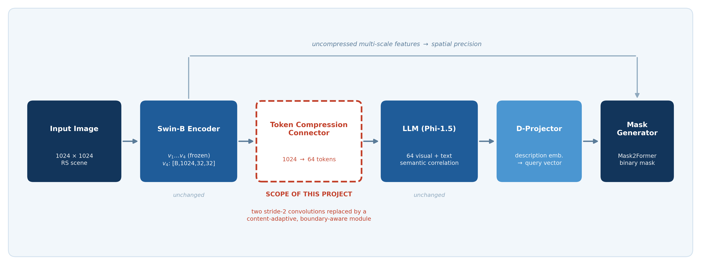
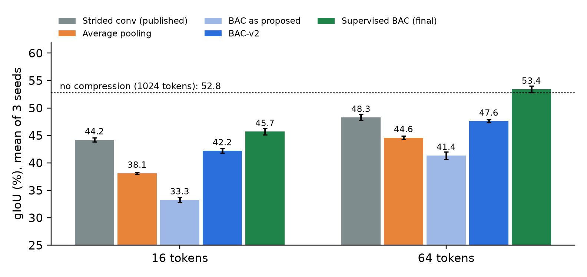
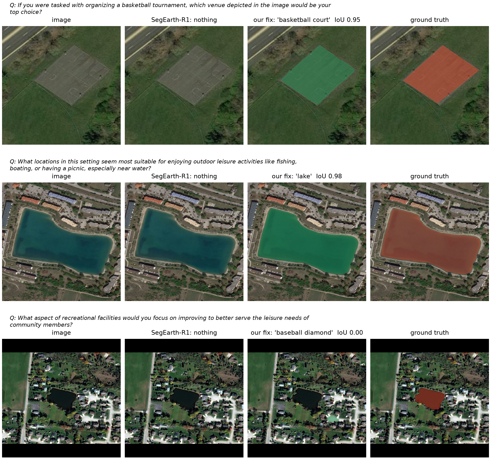
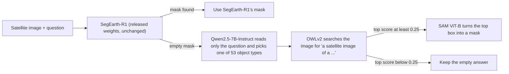

# Boundary-Aware Visual Token Compression for SegEarth-R1

This is our minor project at Manipal Institute of Technology (School of Electrical Engineering).

[SegEarth-R1](https://github.com/earth-insights/SegEarth-R1) answers questions about satellite images with a mask, for example "where could a helicopter land?". It squeezes the image into 64 tokens before the language model reads it. Our idea was that a smarter squeeze would give better masks. The squeeze we built, BAC (boundary-aware compression), spends more tokens on object edges and fewer on plain background.

It did not turn out the way we expected, and the reasons were more interesting than the original idea. We tested this properly, then found where the model really fails and built a small fix for that.

**Team:** Animesh Kumar (230907478), Preyanshi Doshi (230907042)
**Mentor:** Dr. Aarabhi Putty



## What we found

**1. Inside SegEarth-R1, the compressor does not matter.**
- Every compressor we tried scores within about 1 gIoU point of the released one, from 16 to 128 tokens: strided conv, average pooling, random selection, ToMe and BAC. None of the differences is significant.
- The reason is that the masks do not use the image tokens at all. On our 300 validation images:

  | Image tokens given to the model | gIoU |
  |---|---|
  | Real tokens | 68.40 |
  | Tokens set to zero | 68.78 |
  | Another image's tokens | 68.40 |
  | No image tokens | 68.22 |

- The mask decoder gets the image through a separate path, so the language model only has to read the question.
- We saw the same thing with the RRSIS-D model, and we repeated the main runs on a second machine (Kaggle T4): 8 of 8 claims and 30 of 30 configurations matched.

**2. When the tokens really matter, supervised BAC wins.**
- We built a small test bench where the compressed tokens are the only way from the image features to the mask. Every result is the mean of 3 seeds.
- BAC whose edge scores are trained with the true object outlines (used during training only) beats the published strided conv:
  - **+1.5 gIoU at 16 tokens**;
  - **+5.2 gIoU at 64 tokens** (53.4 vs 48.3).
- Two control runs split the +5.2 at 64 tokens into two parts:
  - about +2.3 comes from the extra outline training signal;
  - about +2.8 comes from actually putting tokens on edges.



**3. The real weakness is object types the model never saw in training.**
- Four categories were held out of EarthReason training: basketball court, island, lake and stadium.
- On the official test split the model misses 29% of these targets, against 3% for the categories it was trained on.
- Many of these misses are empty answers: the model simply returns no mask.

**4. A small fallback fixes part of that.**

When SegEarth-R1 returns an empty mask:
1. A language model reads the question and names the object type.
2. An open-vocabulary detector looks for that object in the image.
3. SAM draws the mask.

We use the new mask only when the detector is confident. Results:

| Image set | gIoU change [95% CI] | cIoU change | Images where the fix ran |
|---|---|---|---|
| 535 validation images never used before | +1.62 [+0.75, +2.66] | +1.16 | 19 |
| Official test split (1,928 images) | +1.00 [+0.49, +1.53] | +0.83 | 49 |



In the first two rows SegEarth-R1 returned nothing and the fix found the right object. The last row shows a failure: the question is vague, the fix guessed the wrong type, and it drew the wrong object.

## Datasets

**EarthReason** ([Hugging Face](https://huggingface.co/datasets/earth-insights/EarthReason)) is the main dataset. It was released with SegEarth-R1.
- Each sample is a satellite image, one or more implicit questions about it, a text answer and a ground-truth mask.
- Some questions have no target in the image. For these the correct output is an empty mask.
- Four object types are left out of training on purpose: basketball court, island, lake and stadium. They appear only in validation and test.

| Split | Images | How we used it |
|---|---|---|
| train | 2,371 | training our connectors and the test bench |
| val | 1,135 | split into the three sets below |
| test | 1,928 | the official test split; used for the reproduction check and once for the final fix |

We shuffled the validation images once with seed 0 and cut them into three fixed sets that never overlap:

| Set | Images | Purpose |
|---|---|---|
| `test300` | 300 (positions 1 to 300) | every compressor comparison and token control |
| `calib300` | 300 (positions 301 to 600) | choosing thresholds and settings for the fix |
| `valrest` | 535 (the rest) | untouched until the final check of the fix |

`test300` and `calib300` together form the 600 development images. The image IDs of `test300` are listed in `results/val_subset_ids.txt`.

**RRSIS-D** is a referring segmentation dataset of aerial images, with plain descriptions like "the white ship on the left" instead of reasoning questions. We used it only to check finding 1 on a second model, the released SegEarth-R1 RRSIS-D checkpoint. That check ran on 300 validation samples. The data comes from the link in `SegEarth-R1/docs/Preparation.md`.

**Test bench inputs** are made from EarthReason by `bac/token_bottleneck/extract_features.py`. For the train split and `test300` it stores:
- SegEarth-R1's frozen Swin-B features;
- the masks at 256x256;
- an embedding of each question.

**Name vocabulary** is the 45 scene classes of [NWPU-RESISC45](https://arxiv.org/abs/1703.00121) plus the object classes of [DOTA](https://captain-whu.github.io/DOTA/). After removing duplicates this gives 53 names. Only the class names are used, not the images.

## Final pipeline



Some details:
- The 53 object types are the class names of two public remote sensing datasets, NWPU-RESISC45 and DOTA. They do not come from EarthReason's labels.
- The language model never sees the image or the answer.
- Nothing is trained for the fix.
- We chose the 0.25 threshold and the 7B name model on 600 development images, then tested each once on images that had not been used for anything else. The full protocol, including every idea that did not work, is in [exploration/NOTES.md](exploration/NOTES.md).

### How BAC works

BAC replaces SegEarth-R1's connector, the two strided convolutions that turn 1,024 image features into 64 tokens. Everything else stays frozen.

1. It scores every position of the 32x32 feature grid by how likely it is to sit on an edge. The score mixes a small learned head with a Sobel filter.
2. It keeps the top K positions as separate tokens, with non-maximum suppression so they do not bunch up.
3. The rest of the image is pooled into the remaining M - K context tokens.

The code is in `SegEarth-R1/segearth_r1/model/multimodal_projector/token_compressors.py`. The same file has the variants used on the test bench:
- BAC-v2;
- BAC-q, which also looks at the question;
- the baselines: strided conv, pooling, random and ToMe.

## Repository layout

```
SegEarth-R1/              the original SegEarth-R1 code, with our connector added (see Credits)
bac/                      our experiments inside SegEarth-R1
  common.py               model loading (CUDA, Apple MPS or CPU), connector swap, data, metrics
  test_connectors.py      checks every compressor: output shape, gradient flow, NMS, budget split
  train.py                trains only the connector, everything else frozen
  evaluate.py             gIoU / cIoU on the validation subset, plus the token controls (zero, wrong, none)
  analyze.py              summary tables, paired bootstrap confidence intervals, figures
  diagnostics.py          how much the language model's state moves when the image tokens change
  verify_against_reference.py   compares a fresh run (for example on Kaggle) with our results
  token_bottleneck/       the test bench: feature extraction, training, analysis
  run_*.sh                the queues we used to run everything
exploration/              the fix for unseen object types and the other ideas we tried
  scripts/                one script per step (see "Running the fix" below)
  results/                small result files (names, detector outputs, final scores)
  NOTES.md                our research log
kaggle/                   notebooks and queue scripts for the second-machine runs (Kaggle, 2x T4)
results/                  one CSV (per image) and one JSON (summary) per run, plus summary tables
figures/                  analysis figures
files/                    the project overview figures
demo.ipynb                the live demo, saved with the outputs of a full run
requirements.txt          exact package versions
```

## Setup

We ran everything on an Apple M4 (MPS) with Python 3.11. The code also runs on CUDA, which is what the Kaggle notebooks use.

```bash
python3.11 -m venv .venv
.venv/bin/pip install -r requirements.txt
```

**Weights:** download the released SegEarth-R1 checkpoint (about 3 GB):

```bash
.venv/bin/python -c "from huggingface_hub import snapshot_download; snapshot_download('earth-insights/SegEarth-R1-EarthReason', local_dir='checkpoints/SegEarth-R1-EarthReason')"
```

**Data:** download [EarthReason](https://huggingface.co/datasets/earth-insights/EarthReason) and unzip `train.zip`, `val.zip` and `test.zip` into `data/rs_reason_seg/RSReasonSeg/`.

**RRSIS-D (optional):** the RRSIS-D check also needs:
- the `earth-insights/SegEarth-R1-RRSIS-D` checkpoint, downloaded into `checkpoints/SegEarth-R1-RRSIS-D`;
- the RRSIS-D data, placed in `data/rs_ref_seg/RRSIS-D/` as described in `SegEarth-R1/docs/Preparation.md`.

**Name model:** Qwen2.5 needs a newer `transformers`, so it gets its own small environment:

```bash
python3.11 -m venv exploration/.venv-llm
exploration/.venv-llm/bin/pip install torch==2.5.1 transformers==4.46.3 accelerate==1.1.1
```

OWLv2 and SAM run in the main environment. Their weights download from Hugging Face on first use.

## Running it

Our 300 evaluation images are fixed and listed in `results/val_subset_ids.txt`.

**Checks and the released model**

```bash
.venv/bin/python bac/test_connectors.py
.venv/bin/python bac/evaluate.py --name released
```

**Token controls** (do the masks use the image tokens?)

```bash
.venv/bin/python bac/evaluate.py --name zero --kind zero
.venv/bin/python bac/evaluate.py --name wrong_far --kind wrong_far
.venv/bin/python bac/evaluate.py --name none --kind none
bash bac/run_rrsisd_controls.sh
```

**Training and evaluating a compressor**

```bash
.venv/bin/python bac/train.py --name bac64 --kind bac --tokens 64 --steps 200 --amp
.venv/bin/python bac/evaluate.py --name bac64 --weights runs/bac64/connector.pt
.venv/bin/python bac/analyze.py
```

`bash bac/run_queue.sh` and `bash bac/run_overnight.sh` train and evaluate all 19 connectors we compared. Finished runs are skipped.

**Test bench**

Extract the features once (about 5 GB), then train runs with `run.sh NAME EPOCHS SEED args`:

```bash
.venv/bin/python bac/token_bottleneck/extract_features.py
bash bac/token_bottleneck/run.sh tb_uniform64 6 0 --kind uniform --tokens 64
bash bac/token_bottleneck/run.sh tb_bacq64_supb 6 0 --kind bacq --tokens 64 --sup boundary
.venv/bin/python bac/token_bottleneck/analyze_testbed.py
```

The full set of seeds and controls is in `kaggle/testbed_queue.sh`, `kaggle/explore_queue.sh` and `kaggle/explore2_queue.sh`.

**Running the fix**

```bash
.venv/bin/python exploration/scripts/dump_logits.py test300 calib300 valrest
.venv/bin/python exploration/scripts/dump_logits.py testsplit --meta-only
exploration/.venv-llm/bin/python exploration/scripts/predict_noun.py calib300 test300 valrest testsplit --model Qwen/Qwen2.5-7B-Instruct --refusals-only
.venv/bin/python exploration/scripts/ov_branch.py calib300 test300 valrest testsplit --nouns Qwen2.5-7B-Instruct --mode vocab --refusals-only
.venv/bin/python exploration/scripts/score_policy.py --sets calib300 test300 --names Qwen2.5-7B-Instruct --taus 0.2 0.25 0.3
.venv/bin/python exploration/scripts/score_p2.py
```

What each step does:
1. `dump_logits.py` runs the released model once on every image set.
2. `predict_noun.py` names the object type for each empty answer.
3. `ov_branch.py` runs OWLv2 and SAM on those images.
4. `score_policy.py` picks the threshold on the development sets.
5. `score_p2.py` writes the final numbers to `exploration/results/p2_results.json`.

You can check the final numbers without a GPU. The intermediate files (names, detector scores and masks) are in the repository, so `score_p2.py` runs on its own.

**Demo**

Open `demo.ipynb` with the `.venv` kernel and run all cells. It shows:
- the released model and our compressors on example images;
- the token controls;
- the test bench numbers;
- the fix in action.

## Trained weights

Trained connector weights are not in the repository. They take up about 750 MB, and the commands above recreate them:
- `bac/run_queue.sh` and `bac/run_overnight.sh` recreate everything in `runs/`;
- `kaggle/ft_queue.sh` recreates `exploration/ft_weights/`, the mask-path fine-tuning that we tried and rejected.

The demo works without them. It only shows the compressors whose weights exist in `runs/`.

## Reproduction check

On the official EarthReason test split, the released model scores:

| | gIoU | cIoU |
|---|---|---|
| Our run | 70.40 | 68.05 |
| Paper | 70.75 | 68.25 |

Our numbers come from a different machine and PyTorch version than the paper's.

On the full validation split we get 70.59 gIoU, while the paper reports 68.60. We could not find the reason for this gap.

All our compressor comparisons are paired comparisons on the same images, so they do not depend on this difference.

## Credits

This project builds directly on **SegEarth-R1** by Kaiyu Li, Zepeng Xin, Li Pang, Chao Pang, Yupeng Deng, Jing Yao, Guisong Xia, Deyu Meng, Zhi Wang and Xiangyong Cao: [paper](https://arxiv.org/abs/2504.09644), [code](https://github.com/earth-insights/SegEarth-R1).

The `SegEarth-R1/` folder is their code under the Apache-2.0 licence (see `SegEarth-R1/LICENSE`), taken at commit `e796b3b`. Our changes to it are:
- `segearth_r1/model/multimodal_projector/token_compressors.py` is new. It holds all the compressors, including BAC.
- `segearth_r1/model/multimodal_projector/builder.py` registers the new compressors.
- `ms_deform_attn.py` and `ms_deform_attn_func.py` in the pixel decoder fall back to the pure PyTorch version of deformable attention when the compiled CUDA op is missing, so the model runs on Apple Silicon and CPU.

We also use:
- the [EarthReason](https://huggingface.co/datasets/earth-insights/EarthReason) and RRSIS-D datasets;
- [Qwen2.5-7B-Instruct](https://huggingface.co/Qwen/Qwen2.5-7B-Instruct) for naming the object type;
- [OWLv2](https://huggingface.co/google/owlv2-base-patch16-ensemble) for detection;
- [SAM](https://huggingface.co/facebook/sam-vit-base) for masks;
- the class names of NWPU-RESISC45 and DOTA;
- the ToMe token merging method (Bolya et al., 2023) as a baseline.

We thank our mentor, Dr. Aarabhi Putty, for their guidance throughout the project.

## Licence

Our code is released under the Apache-2.0 licence (see `LICENSE`). The `SegEarth-R1/` folder keeps its own
Apache-2.0 licence and copyright from the original authors.
